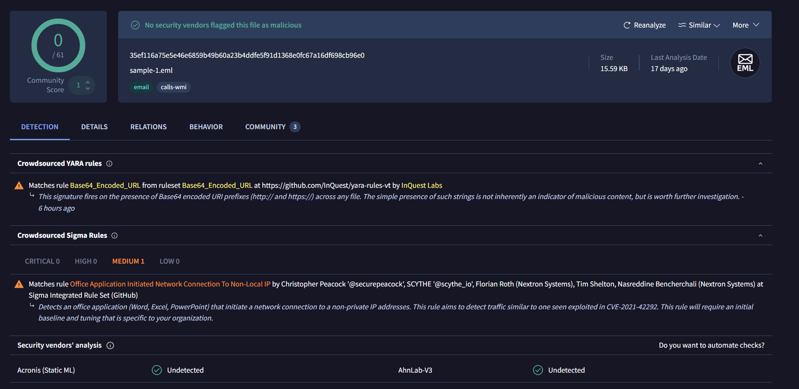
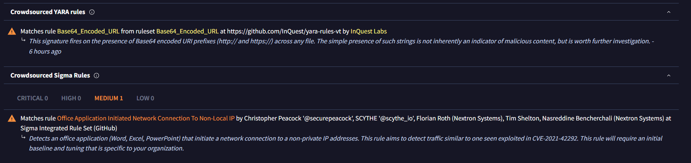
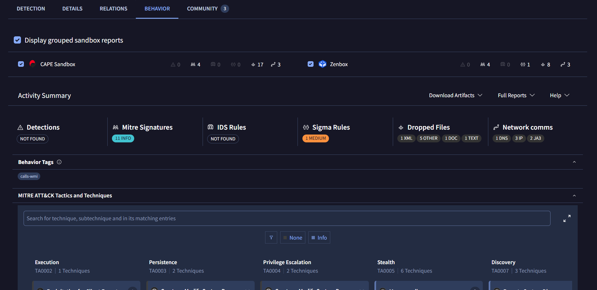
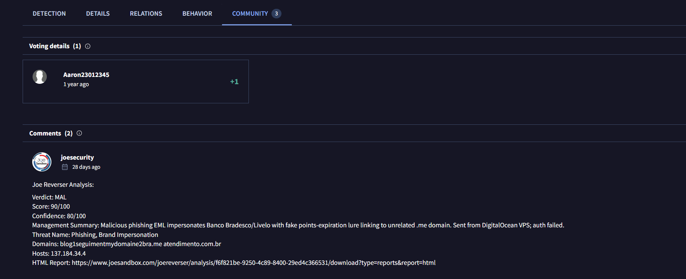
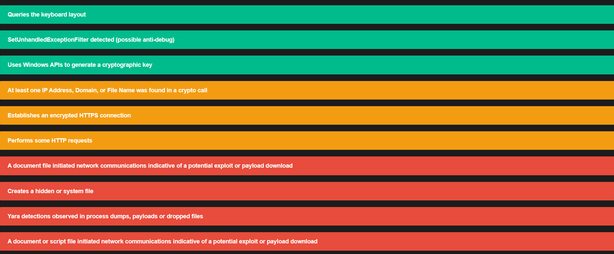
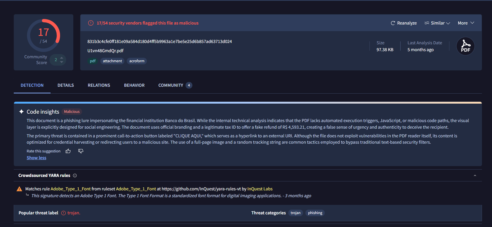
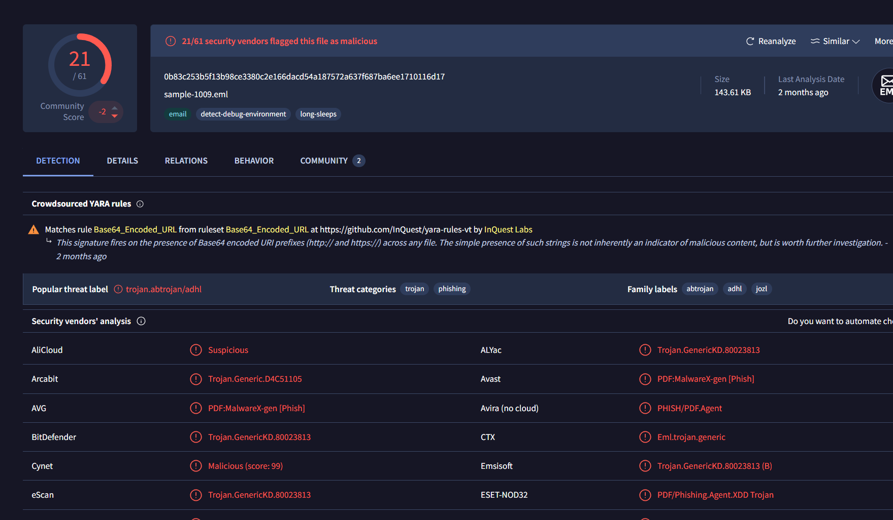
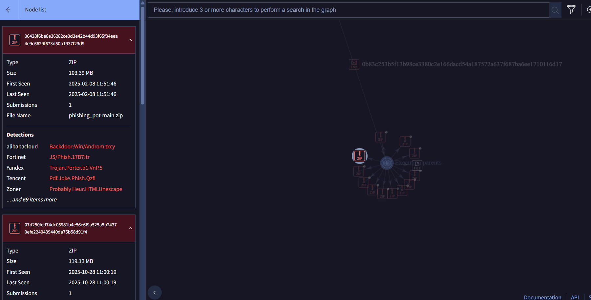

# Phishing Email Analysis

**Document Reference:** `PR-2026-10-13`

**Author:** `Adegboyega Samuel`

**Date:** `October 13, 2026`

**Status:** `Draft`

Phishing remains one of the primary entry vectors for cyber threats and organizational breaches. This project focuses on the systematic analysis of suspected phishing emails to identify malicious artifacts, dissect social engineering tactics, and extract key Indicators of Compromise (IOCs). By analyzing headers, authentication mechanisms, and payloads, this documentation outlines practical methodologies for threat detection, incident triage, and defensive response.

The sample i used in this lab were sourced for and said to be potential phishing mails.

## Sample 1

| Field                      |  observation |
| -------------------------- | ---------------- |
| Case ID                    |     PH-001     |
| Filename                   |   [Sample 1](samples/sample-1.eml)               |
| SHA-256                    |  35EF116A75E5E46E6859B49B60A23B4DDFE5F91D1368E0FC67A16DF698CB96E0 |
| Subject                    |  CLIENTE PRIME - BRADESCO LIVELO: Seu cartão tem 92.990 pontos LIVELO expirando hoje! |
| From                       |   BANCO DO BRADESCO LIVELO <banco.bradesco@atendimento.com.br>  |
| To                         |   phishing@pot   |
| Authentication-Results     |  spf=temperror (sender IP is 137.184.34.4) smtp.mailfrom=ubuntu-s-1vcpu-1gb-35gb-intel-sfo3-06; dkim=none (message not signed) header.d=none;dmarc=temperror action=none header.from=atendimento.com.br;compauth=fail reason=001 spf=temperror (sender IP is 137.184.34.4) smtp.mailfrom=ubuntu-s-1vcpu-1gb-35gb-intel-sfo3-06; dkim=none (message not signed) header.d=none;dmarc=temperror action=none header.from=atendimento.com.br;compauth=fail reason=001  |
| Number of Received headers |    9   |
| Initial observations       |                  |
| Return-Path | root@ubuntu-s-1vcpu-1gb-35gb-intel-sfo3-06 |

## Analysis

**Full header analysis here**: [Here](evidence/reports/sample-1-header-analysis.md)

The mail subject which says `CLIENTE PRIME - BRADESCO LIVELO: Seu cartão tem 92.990 pontos LIVELO expirando hoje!`
is a portuguese text that roughly transkates to
 `"PRIME CUSTOMER - BRADESCO LIVELO: Your card has 92,990 LIVELO points expiring today!"`. The first key thing i could point at is `expiring today` this is a common social engineering technique, Urgency is commonly used in phishing to encourage recipients to act without carefully examining a message.

 Another thing i also noticed, The message invokes Bradesco, a Brazilian bank, and Livelo, a Brazilian rewards program.

An attacker could exploit trust in these organizations to persuade a recipient to click a link or disclose information.

The claim that 92,990 points are expiring could be legitimate marketing, fabricated bait, or an attempt to lure a recipient to a fraudulent website.

### VirusTotal analysis

The message didn't really have message body i could work with, so i uploaded the SHA256 hash to VirusTotal for further analysis.

The community score say 0/61, that means this might not be a phishing mail, however there are additional color-coded information that could be useful, it doesn't prove whether or not it is a phishing mail. It just states where the hash might have existed and it refrenced them.

In the relations Tab, there wasn't really much information that suggests that this mail is malicious, these were just additonal information when it was ran in a sandbox.

I was almost starting to believe this actually a legitimate email until i saw a report in the community tab. It say `Malicious phishing EML impersonates Banco Bradesco/Livelo with fake points-expiration lure linking to unrelated .me domain. Sent from DigitalOcean VPS; auth failed.` and categorixed it as `Phishing, Brand Impersonation`

### Findings from Cape sandbox:

The email has the capability of potentially creating `Creates a hidden or system file`, it can also initiate network communications indicative of a potential exploit or payload download. 

### Sample 1 Summary

Based on the findings and evidence presented, i will label this a phishing mail.

[Full report from Cape sandbox here](<evidence/reports/Sample1_VT_CAPE Sandbox.html>)

## Sample 2

| Field                      |  observation |
| -------------------------- | ---------------- |
| Case ID                    |     PH-002    |
| Filename                   |   [Sample 2](samples/sample-1009.eml)               |
| SHA-256                    |  0b83c253b5f13b98ce3380c2e166dacd54a187572a637f687ba6ee1710116d17 |
| Subject                    | =?utf-8?B?Q3LDqWRpdG8gSVIgTGliZXJhZG8gLSB2NVYwWlZSZTFIamF6?==?utf-8?B?bGlxUW9Zeg==?= |
| From                       |   "[BB] - Comunicado ao cliente - Cod.  3391350884491727" <sel553r@gmail.com>  |
| To                         |   phishing@pot   |
| Authentication-Results     |  spf=pass (sender IP is 209.85.222.173) smtp.mailfrom=gmail.com; dkim=pass (signature was verified) header.d=gmail.com;dmarc=pass action=none header.from=gmail.com;compauth=pass reason=100  |
| Number of Received headers |    15   |
| Return-Path | sel553r@gmail.com |
|Sender IP | 209.85.222.173 |

**Full header analysis here**: [Here](evidence/reports/sample-1009-header-analysis.md)

According to the header, there is a pdf attached to this, the mail itself appears legit but the attached document is malicious.
>**VirusTotal AI overview:** This document is a phishing lure impersonating the financial institution Banco do Brasil. While the internal technical analysis indicates that the PDF lacks automated execution triggers, JavaScript, or malicious code paths, the visual layer is explicitly designed for social engineering. The document uses official branding and a legitimate tax ID to offer a fake refund of R$ 4,593.21, creating a false sense of urgency and authenticity to deceive the recipient.
The primary threat is contained in a prominent call-to-action button labeled "CLIQUE AQUI," which serves as a hyperlink to an external URI. Although the file does not exploit vulnerabilities in the PDF reader itself, its content is optimized for credential harvesting or redirecting users to a malicious site. The use of a full-page image and a random tracking string are common tactics employed to bypass traditional text-based security filters.

### VirusToal Analysis

The first scan result by VirusTotal was enough for me to conclude that this is a malicious email. 

## 1. High-Level Summary

* **Verdict:** **Malicious**

* **Popular Threat Label:** `trojan.abtrojan/adhl`

* **Primary Categories:** `trojan`, `phishing`

* **Associated Family Labels:** `abtrojan`, `adhl`, `jozl`

* **Detection Status:** Widely flagged across major security engines (e.g., BitDefender, Avast, ESET, Google, McAfee).

---

## 2. Key Findings & Technical Breakdown

### A. Artifact Type: Malicious PDF / Email Attachment

* Multiple engines explicitly flag the file as a PDF-based threat:
* **Avast / AVG:** `PDF:MalwareX-gen [Phish]`

* **Avira / WithSecure:** `PHISH/PDF.Agent` / `Phishing.PHISH/PDF.Agent`

* **ESET-NOD32:** `PDF/Phishing.Agent.XDD Trojan`

* **Tencent:** `Pdf.Trojan.Pdf.Adhl`

* **Varist:** `PDF/ABTrojan.JOZL-`

### B. Threat Mechanism & Behavior

1. **Phishing PDF Lure:** The file appears to be a PDF lure attachment commonly distributed via phishing emails (`.eml` / email-based delivery vector indicated by `Eml.trojan.generic` and `Trojan.Email.Generic.4!c`).

2. **Dual Classification (Trojan + Phishing):**
* **Phishing Component:** Contains embedded links, redirects, or fake authentication landing pages designed to harvest credentials.

* **Trojan Component:** May contain malicious PDF JavaScript, embedded streams, or external link triggers to drop secondary payloads onto the host system.

---

## 3. Findings

| Metric / Parameter | Value / Finding | Context |
| --- | --- | --- |
| **Detection Result** | Malicious (Multi-Vendor Consensus) | High Confidence Flag |
| **Primary Classification** | `trojan.abtrojan/adhl`  | VirusTotal Popular Threat Label |
| **Threat Vector** | Email Attachment / PDF Phishing Lure | Spear phishing payload |
| **Vendor Detections** | BitDefender, ESET, Avast, McAfee, Google, AVG, etc. | Widespread engine coverage |
| **MITRE ATT&CK TTPs** | `T1566.001` (Spearphishing Attachment) | Technical Delivery Mechanism |

---

## Cape Sandbox Analysis

### Execution Overview

* **Sandbox Environment:** Cuckoo Version 2.4-CAPE

* **Target Operating System:** Windows 10 (`win10_3` managed via KVM)

* **Execution Window:** Started on March 25, 2025, at 04:18:33 and completed at 04:21:26 (Duration: 173 seconds)

---

## Behavioral Signatures & Threat Indicators

The sandbox report flagged several critical security signatures, indicating malicious behavior, potential exploitation, and evasion techniques:

* **Exploitation & Payloads:**
* Detected a possible heap spray exploit.

* Identified stack pivoting when a critical API was called.

* Noted that a document file initiated network communications indicative of a potential exploit or payload download.

* Recorded that a potential decoy document was displayed to the user.

* **Evasion & Defense Evasion:**
* Detected `SetUnhandledExceptionFilter`, which is commonly used for anti-debugging purposes.

* **Reconnaissance & Environment Checks:**
* Checked available memory, queried the computer hostname, checked the keyboard layout, and checked system language via registry keys (potential geofencing).

* **Cryptographic & Network Activity:**
* Used Windows APIs to generate a cryptographic key, with at least one IP address, domain, or file name found within a crypto call.

* Performed standard HTTP requests and established encrypted HTTPS connections.

* Created hidden or system files.

---

## Network Analysis

* **DNS Queries:** The sandbox resolved various telemetry, update, and authentication domains associated with Microsoft/Windows infrastructure (e.g., `ctldl.windowsupdate.com`, `login.live.com`, `settings-win.data.microsoft.com`, `client.wns.windows.com`) alongside Certificate Revocation List (CRL) traffic to Let's Encrypt (`x1.c.lencr.org`).

* **Traffic Protocols:** Outbound traffic included TCP and UDP connections over standard ports (such as DNS over port 53, HTTP over port 80, HTTPS over port 443, and NTP over port 123).

---

## Dropped Files

The analysis logged multiple dropped files associated with local application caches, configurations, and templates (primarily targeting Microsoft Office and Outlook paths under `C:\Users\Bruno\`):

* **Outlook & RoamCache XML Data:** Files such as `Stream_Calendar_2_...dat`, `Stream_RssRule_2_...dat`, `Stream_ConversationPrefs_2_...dat`, `Stream_TCPrefs_2_...dat`, `Stream_TableViewPreviewPrefs_2_...dat`, and `Stream_ContactPrefs_2_...dat`.

* **Templates & Dictionaries:** Microsoft Word template `NormalEmail.dotm` and user dictionary `CUSTOM.DIC`.

* **Office Web Service Cache:** XML configuration files generated under the Office web service cache directory containing endpoints for Office online services and telemetry.

### The detected memory/exploit signatures

Based on the Cuckoo Version 2.4-CAPE sandbox report, the memory and exploit signatures indicated a sophisticated attack chain—likely delivered via a malicious document file—designed to manipulate process memory and hijack execution flow.

Here is a detailed breakdown of the detected memory and exploit signatures:

## 1. Heap Spraying

* **Signatures Flagged:** *Heap spray exploit detected*.

* **Mechanism:** Heap spraying involves allocating large blocks of memory filled with repetitive patterns containing shellcode and NOP sleds. The goal is to force predictable memory addresses so that when a vulnerability (such as a use-after-free or buffer overflow) occurs, the instruction pointer (`EIP`/`RIP`) can be redirected into the sprayed heap region, executing the attacker's payload.

## 2. Stack Pivoting

* **Signatures Flagged:** *Stack pivot detected during a critical API call*.

* **Mechanism:** A stack pivot occurs when an exploit overwrites the stack pointer register (`ESP`/`SP`) to point to an attacker-controlled memory location (often within the sprayed heap or a Return-Oriented Programming/ROP chain). This bypasses traditional security mechanisms like stack cookies or Data Execution Prevention (DEP) by shifting the execution context to a fake stack where ROP gadgets or shellcode can be chained together.

## 3. Exploit Delivery via Document Files

* **Signatures Flagged:** *Document file initiated network communications (potential exploit/payload)* and *Decoy document displayed*.

* **Mechanism:** These indicators reveal how the exploit likely operated in real-time. A malicious carrier document (such as a Word or PDF file) opened inside the sandbox:

* Triggered an exploitation vector (such as a memory corruption flaw) to achieve code execution.
* Opened a **decoy document** to keep the user distracted while the malicious payload executed silently in the background.

* Initiated a secondary network request to pull down additional payloads, configuration files, or staging infrastructure.

## 4. Anti-Debugging and Evasion

* **Signatures Flagged:** *`SetUnhandledExceptionFilter` called*.

* **Mechanism:** While structured exception handling is standard in Windows applications, malware frequently hooks or registers unhandled exception filters to intercept debugging exceptions. This prevents security analysts and automated sandboxes from stepping through the code cleanly, helping the exploit evade analysis.

## The risk Involved

The findinds were so interesting that had to draft out the risk involved in this sample.

## 1. Remote Code Execution (RCE) and System Takeover

* **Risk:** The combination of heap spraying and stack pivoting means the sample successfully exploited a vulnerability (likely in an application parsing the document) to hijack the processor's execution flow.
* **Impact:** Once an attacker achieves arbitrary code execution via memory manipulation, they can run native system commands, deploy persistent backdoors, install ransomware, or pivot deeper into the internal network.

## 2. Security Control Bypass (Defense Evasion)

* **Risk:** Stack pivoting is explicitly used to circumvent modern exploit mitigations like Data Execution Prevention (DEP) and stack cookies.
* **Impact:** By shifting the execution stack to a controlled memory region, the payload bypasses hardware-enforced protections designed to stop code from running in data segments, allowing shellcode to execute freely.

## 3. Stealth, Social Engineering, and Persistence

* **Risk:** The presence of a decoy document alongside network communication from the document file points to a targeted delivery mechanism.

* **Impact:** Displaying a decoy document keeps the user unaware that a breach is happening in the background. Meanwhile, outbound network requests allow the initial exploit to fetch secondary payloads, stage additional tools, or establish Command-and-Control (C2) channels.

However if this sample was at any point executed, refer to the recommendations below for mitigating or containing the risk. I tailored this in relation to the report generated from `cape sandbox`.

---

## Phase 1: Immediate Containment

If this sample was executed on a live corporate or personal endpoint, immediate action is required to prevent lateral movement or data exfiltration:

* **Network Isolation:** Disconnect the compromised machine from the network immediately (unplug the Ethernet cable or disable Wi-Fi) to cut off potential Command-and-Control (C2) communication.
* **Process Termination:** Terminate any lingering malicious or suspicious processes spawned by the document handler (e.g., Word, Excel, Outlook).
* **Volatile Memory Preservation:** If you have forensic capabilities, capture a RAM dump before rebooting the machine. This preserves evidence of the heap spray, stack pivot, and shellcode in memory.

---

## Phase 2: Host Remediation & Forensics

* **Artifact Cleanup:** Inspect and remove dropped files, rogue templates (such as modified `.dotm` files), and local application caches tied to the execution window.

* **Deep Scan:** Run a full-system antivirus or Endpoint Detection and Response (EDR) scan to check for secondary persistence mechanisms (e.g., scheduled tasks, registry run keys, or dropped backdoors).
* **Credential Rotation:** Assume any credentials stored, typed, or cached on the compromised machine during or after the execution window may have been compromised. Rotate passwords and invalidate active sessions for accounts tied to the user.

---

## Phase 3: Defensive Hardening & Prevention

To mitigate the risk of future memory corruption and exploit execution, implement the following technical controls:

* **Enforce Attack Surface Reduction (ASR) Rules:**
* Configure Microsoft Defender (or your EDR equivalent) to block Office applications from creating child processes, injecting code into other processes, or launching executable content.

* **Leverage Hardware & OS-Level Mitigations:**
* Ensure **Data Execution Prevention (DEP)** and **Address Space Layout Randomization (ASLR)** are globally enforced.
* Enable **Control Flow Guard (CFG)** and **Hardware-enforced Stack Protection** to disrupt stack pivoting and control-flow hijacking techniques.

* **Tighten Macro and Document Policies:**
* Block macros from running on files downloaded from the internet via Group Policy or Intune.
* Deploy Content Disarm and Reconstruction (CDR) or email gateway sandboxing to strip or neutralize risky embedded objects and exploits before they reach end-user inboxes.

* **Patch Management:**
* Maintain rigorous patching cycles for operating systems, Office productivity suites, and web browsers to close the underlying vulnerabilities that allow heap-spraying vectors to succeed.

### Other findings:

I further analysed this sample using virustotal sample, i discovered that it is a child node from a parent node. What this means is that the sample is from a list of other related samples. Most of which are potentially more dangerous that current node in consideration.

Other children node: [children node here](evidence/reports/children_nodes.csv)

full cape sandbox report: [here](<evidence/reports/Sample_2_VT_CAPE Sandbox.html>)

## Sample 2 Suammary

The analyzed sample represents a highly sophisticated, multi-stage malicious file (likely a weaponized document) designed to achieve system compromise via advanced memory corruption and code execution techniques. The execution profile reveals clear indicators of automated exploit delivery, defense evasion, and post-exploitation staging within a Windows 10 environment. The combination of memory manipulation, execution flow hijacking, and external communication classifies this sample as a critical-risk threat capable of unauthorized remote code execution. Immediate containment, endpoint isolation, forensic RAM analysis, and robust defense-in-depth hardening (such as Attack Surface Reduction rules and strict macro policies) are strongly recommended. Based on all these it is concluded that this is a phishing mail.

## VERDICT
## Sample 1 — Bradesco/Livelo Points-Expiration Email

**Verdict: MALICIOUS — PHISHING**

**Confidence: High**

**Rationale:** The email uses an urgent points-expiration notification associated with the Bradesco/Livelo brands to pressure the recipient into taking action. The sender infrastructure raises additional concerns, including a return-path mismatch and inconclusive SPF and DMARC authentication results. Threat-intelligence reporting also associates a similar email with phishing activity.

**Conclusion:**

> The email is assessed as malicious and consistent with a phishing attempt. The urgency-based points-expiration lure, suspicious sender infrastructure, and associated threat-intelligence findings support this assessment. Although the initial VirusTotal scan returned no detections, this result does not establish legitimacy. The email should be treated as malicious, with further investigation focused on validating the associated indicators and determining whether any recipients were affected.

---

## Sample 2 — Credit-Related Email with Gmail Sender

**Verdict: LIKELY MALICIOUS — PHISHING / MALICIOUS ATTACHMENT SUSPECTED**

**Confidence: Moderate to High, pending artifact verification**

**Rationale:** The email passed SPF, DKIM, and DMARC authentication checks, but these results establish aspects of sender authentication—not whether the message content is safe. The VirusTotal findings documented in my report include multiple detections associated with a potentially malicious PDF or phishing activity.

**Conclusion:**

> The email is assessed as likely malicious, with suspected phishing activity involving a potentially malicious PDF attachment. Although SPF, DKIM, and DMARC authentication checks passed, these results do not establish the legitimacy of the message or its contents. Threat-intelligence findings raise concerns about the associated attachment. A definitive conclusion should be based on verifying the attachment's identity, correlating the reported detections with its hash, and reviewing the available behavioral evidence.

---

## Final Verdict Summary

| Attribute            | Sample 1                                                                                    | Sample 2                                                                      |
| -------------------- | ------------------------------------------------------------------------------------------- | ----------------------------------------------------------------------------- |
| Verdict              | **Malicious — Phishing**                                                                    | **Likely malicious — Phishing / suspected malicious attachment**              |
| Confidence           | High                                                                                        | Moderate to high, pending artifact verification                               |
| Primary indicators   | Urgency-based lure, suspicious sender infrastructure, related threat-intelligence reporting | Threat-intelligence detections associated with a potentially malicious PDF    |
| Email authentication | SPF and DMARC returned `temperror`; DKIM absent                                             | SPF, DKIM, and DMARC passed                                                   |
| VirusTotal result    | 0/61 detections                                                                             | Multiple detections reported for the relevant artifact                        |
| Key limitation       | Confirm the external report's connection to this exact email                                | Confirm whether the detections concern the original email or its attachment   |
| Recommended handling | Treat as malicious and investigate exposure                                                 | Quarantine pending artifact verification; handle the attachment as suspicious |